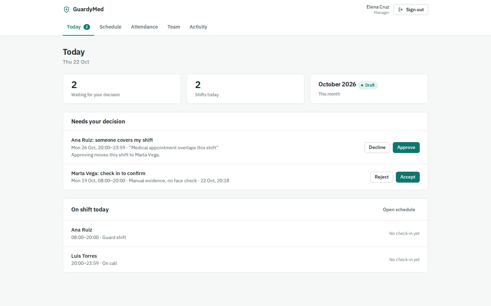
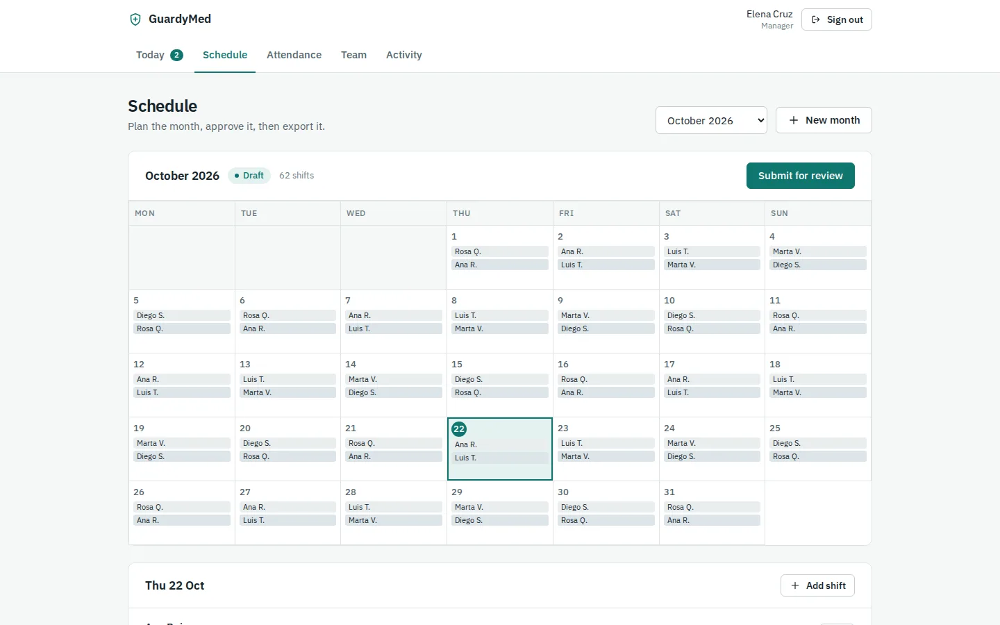
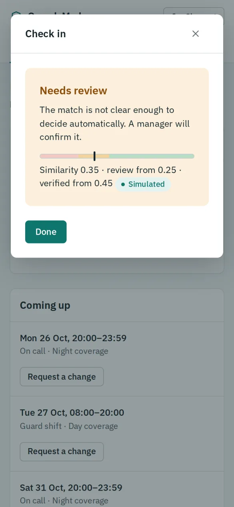
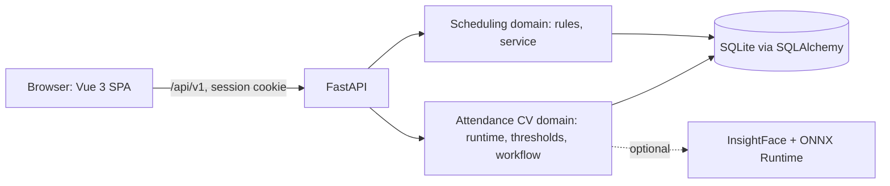
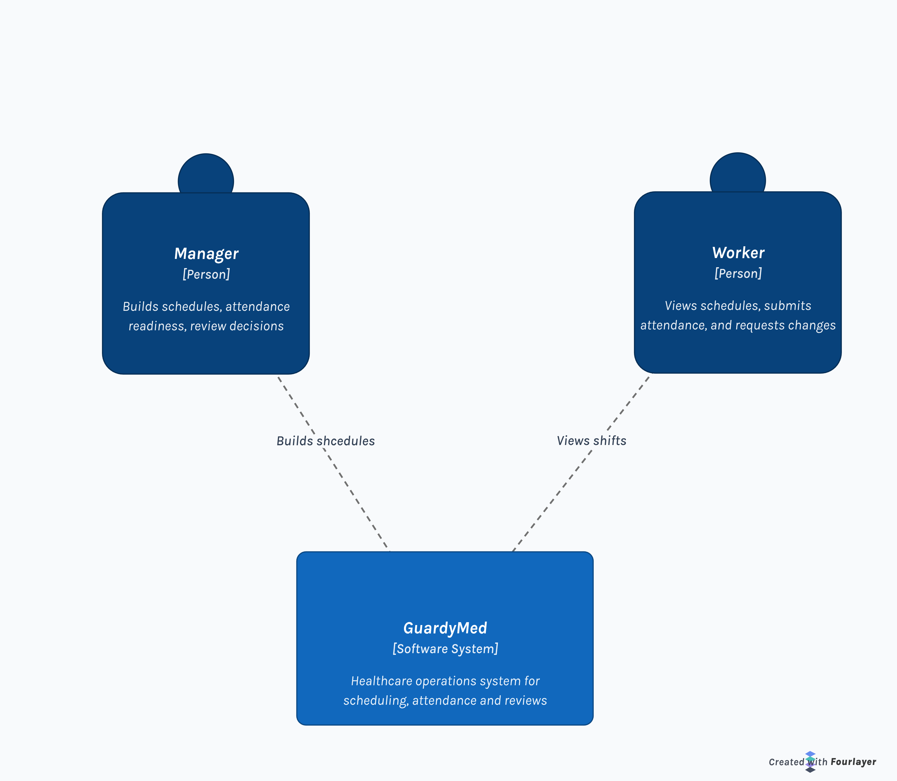
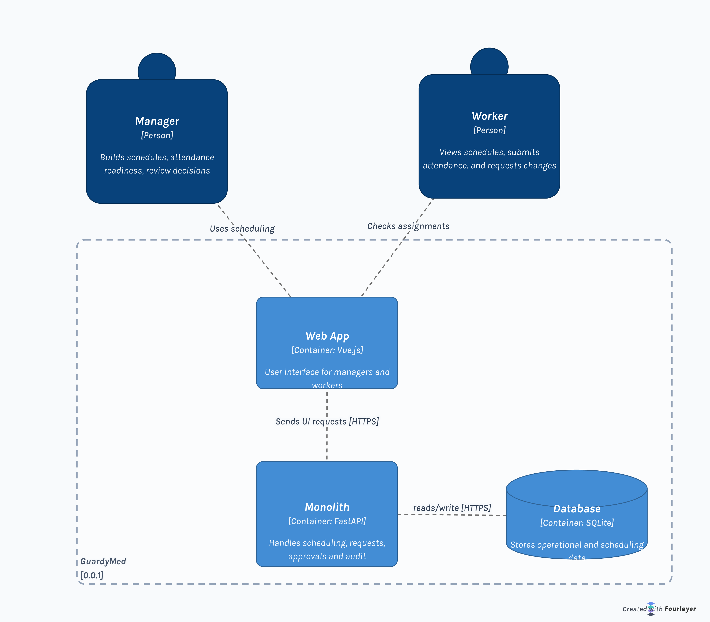
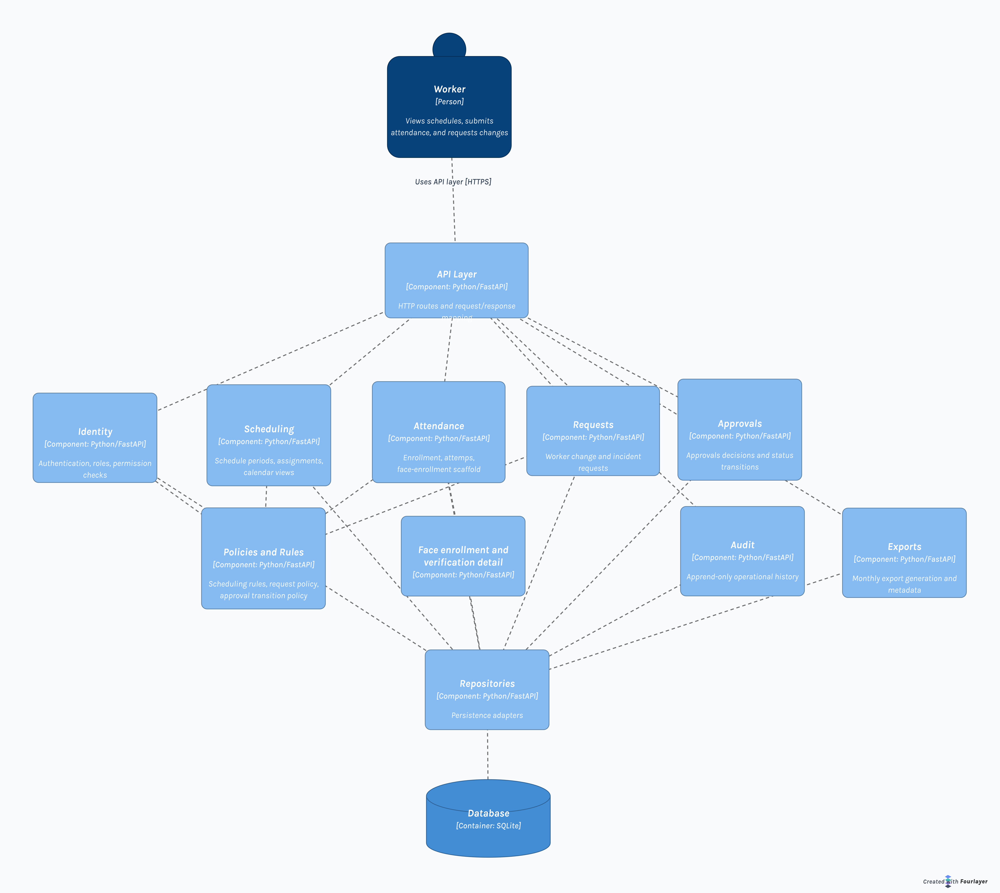

# GuardyMed

Guard scheduling, worker requests and face-verified attendance for hospital teams, as a small FastAPI + Vue application.

[](https://github.com/eJosR-Coding/GuardyMed/actions/workflows/ci.yml)
`v0.2.0` · Python 3.11+ · Vue 3 · SQLite

<p>
  
  
</p>
<p>
  
</p>

## The problem

Hospital guard rosters tend to live in spreadsheets and chat threads. Schedules are hard to validate before they
go live, worker requests are detached from the shift they refer to, attendance evidence is inconsistent, and
nobody can later say who approved what. GuardyMed keeps the schedule, the worker's requests, the attendance
evidence and the manager's decisions in one place, with an audit trail.

## What you can do

**Managers**
- Plan a month: pick a day on the calendar, add shifts (overlaps, department and date rules are checked), submit for review, approve.
- Decide on worker requests in one list. Approving a replacement moves the shift to the colleague named in the request.
- Confirm check-ins that face verification could not decide on its own.
- Enroll people for face check-in, add people to the team, and read the activity log (who changed what, when).
- Export an approved month as CSV: shifts, hours per person, or attendance evidence.

**Workers**
- See their own shifts, with today's shift on top.
- Check in and out with face verification, or send a manual check-in for review when the camera is unavailable.
- Request a change from the shift itself (replacement, swap, adjustment, incident) and follow its status.

Managers can be organisation-wide or limited to one department; workers only ever see their own data and their
department's colleague names.

## Try it

You need [uv](https://docs.astral.sh/uv/) and Python 3.11+. Node is only needed to change the frontend, because the
production build is committed.

```bash
git clone https://github.com/eJosR-Coding/GuardyMed.git
cd GuardyMed
make demo                      # or: uv run uvicorn apps.api.app.main:app --port 8000
```

Open <http://127.0.0.1:8000/app> and choose **Continue as manager** or **Continue as worker**. The first click creates
the demo accounts and sample data (dated relative to today). If port 8000 is taken, use `make demo PORT=8010`.
A guided tour is in [docs/DEMO_FLOW.md](docs/DEMO_FLOW.md).

Working on the frontend:

```bash
make install                                        # backend + frontend dependencies
make dev                                            # API with reload on :8000
pnpm --dir apps/frontend dev                        # Vite on :5173, proxies /api (GUARDYMED_API=... if the API is elsewhere)
make build                                          # rebuild apps/web, the bundle FastAPI serves under /app
```

## Architecture



A modular monolith: one FastAPI app serves the API and the built frontend. Business rules live in
`apps/api/app/domain/*/rules.py` and the services, not in the routes. The face-verification runtime sits behind a
small protocol, so the real model and the demo stub are interchangeable. More diagrams:
<details><summary>C4 diagrams</summary>





</details>

```
apps/api/app/      FastAPI app: routes, auth, core (config, error envelope), domain (scheduling, attendance_cv), infra (db)
apps/frontend/     Vue 3 + Vite source (no UI framework; hand-written CSS, self-hosted IBM Plex Sans)
apps/web/          committed production build, served at /app
scripts/           face verification evaluation
tests/             pytest suite (API flows, RBAC, rules, CV outcomes)
docs/              roadmap, AI services, demo walkthrough, evaluation results
```

## AI services

There is one AI feature: **face verification for attendance**. A worker is enrolled once; at check-in a capture is
turned into a face embedding and compared (cosine similarity) with the enrolled one. The score is routed:

| Similarity | Outcome | What happens |
| --- | --- | --- |
| 0.45 or higher | **Verified** | Attendance is recorded automatically |
| 0.25 up to 0.45 | **Needs review** | A manager confirms or rejects it |
| below 0.25 | **Not verified** | Recorded as rejected; the worker can retry |

Things the product does on purpose: no usable face or a blurry one is a retry, not a failed attendance; several faces
in the frame are never auto-accepted; a template made by another model is refused with a clear error; images are not
stored, only the numeric embedding; every automatic decision stores its score, thresholds and model name.

**Two runtimes.** The default is a **simulated demo runtime** that needs no ML packages. It does *not* recognise faces:
it makes the workflow demonstrable (the UI offers ready-made "same person / poor lighting / different person" captures)
and says so everywhere it appears. The **real runtime** uses InsightFace `buffalo_l` (SCRFD detector and a
ResNet-50 ArcFace recogniser, through ONNX Runtime on CPU). Enable it with:

```bash
uv sync --extra cv
GUARDYMED_ATTENDANCE_CV_RUNTIME=insightface make demo    # first run downloads ~280 MB of weights to ~/.insightface
```

If the real runtime cannot start, the app falls back to the demo runtime and reports why on the Attendance screen and
at `GET /api/v1/scheduling/attendance/cv/status`.

**Evaluation** (LFW test pairs, 1,000 pairs, real runtime; details and caveats in [docs/AI_SERVICES.md](docs/AI_SERVICES.md)):

| Measure | Result |
| --- | --- |
| Pairs scored (same / different person) | 492 / 497 (11 of 1,000 pairs had no extractable face) |
| AUC / equal error rate | 0.981 / 3.8% |
| Different people wrongly **verified** at the shipped thresholds | **0 of 497** (95% upper bound 0.8%) |
| Same person: verified / needs review / not verified | 94.9% / 0.8% / 4.3% |

The thresholds were tuned on this same data, so treat the false-accept figure as optimistic; 497 impostor pairs cannot support a
tighter claim than "below about 0.8%". Reproduce with `make eval`.

**Limits, stated plainly.** There is no liveness check, so a printed photo of an enrolled person would pass. LFW is
frontal-ish celebrity photos, not a hospital corridor camera; the numbers say the model separates people well, not that
this deployment is secure. Use it as a convenience with human review, not as the only control. **Licences:** the
InsightFace code is MIT, but its pretrained `buffalo_l` weights are for **non-commercial research use only**, and LFW is
for research use. Weights and datasets are never committed; check the terms before any commercial use. Document
intelligence (OCR) and an assistant are *planned*, not implemented; see the [roadmap](docs/ROADMAP.md).

## Configuration

All settings are environment variables (see [.env.example](.env.example)).

| Variable | Default | Meaning |
| --- | --- | --- |
| `GUARDYMED_DATABASE_URL` | `sqlite+pysqlite:///./guardymed.db` | SQLAlchemy URL. Only SQLite is tested |
| `GUARDYMED_DEMO_MODE` | `true` | Public demo bootstrap and sample data. Set `false` for anything real |
| `GUARDYMED_SESSION_COOKIE_SECURE` | `false` | Set `true` behind HTTPS |
| `GUARDYMED_ATTENDANCE_CV_RUNTIME` | `stub` | `stub` or `insightface` |
| `GUARDYMED_ATTENDANCE_CV_ACCEPT_THRESHOLD` / `..._REVIEW_THRESHOLD` | `0.45` / `0.25` | Routing thresholds |

## API

Interactive docs at `/docs` while the app runs. Everything is under `/api/v1` (`/auth/*`, `/scheduling/*`). Errors always look
like `{"detail": "...", "code": "conflict"}`; validation errors add `fields`. Sessions are HttpOnly cookies; roles are
`manager` and `worker`.

## Tests and CI

```bash
make test        # 88 backend tests, ~35 s, uses a throwaway SQLite database
make build       # frontend production build
```

GitHub Actions runs both on every push to `main` and on pull requests ([.github/workflows/ci.yml](.github/workflows/ci.yml)).

## Status

v0.2.0 is a finished, demoable MVP. Deliberately not done: liveness, check-in time windows, database migrations, sign-in
rate limiting, user administration, production deployment. See the [roadmap](docs/ROADMAP.md) and the
[changelog](CHANGELOG.md).

## Licence

No licence has been chosen yet, so by default all rights are reserved by the author. Third-party components keep their own
licences (notably the InsightFace model weights, non-commercial).
